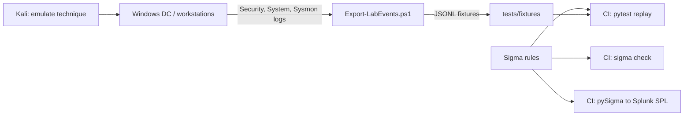

# AD Purple Team Lab


Detection engineering against common Active Directory attack techniques, built and
validated in an isolated home lab. Each technique is emulated in the lab, the
resulting Windows telemetry is captured, and a Sigma detection is written and
**automatically tested in CI** against both true-positive and benign events.

> Attack emulation follows the TCM Security *Practical Ethical Hacking* AD sections.
> This repo contains only the defensive side: logging config, detections, tests, and write-ups.

## Detection coverage

| Technique | ATT&CK | Rule | Data source | Severity |
|---|---|---|---|---|
| Kerberoasting | [T1558.003](https://attack.mitre.org/techniques/T1558/003/) | [kerberoasting_rc4_tgs_request](detections/kerberoasting_rc4_tgs_request.yml) | Security 4769 | Medium |
| AS-REP roasting | [T1558.004](https://attack.mitre.org/techniques/T1558/004/) | [asrep_roasting_no_preauth](detections/asrep_roasting_no_preauth.yml) | Security 4768 | Medium |
| DCSync | [T1003.006](https://attack.mitre.org/techniques/T1003/006/) | [dcsync_replication_by_non_dc](detections/dcsync_replication_by_non_dc.yml) | Security 4662 | High |
| Pass-the-hash / NTLM relay | [T1550.002](https://attack.mitre.org/techniques/T1550/002/), [T1557.001](https://attack.mitre.org/techniques/T1557/001/) | [ntlm_network_logon_keylength_zero](detections/ntlm_network_logon_keylength_zero.yml) | Security 4624 | Medium |
| Remote service execution | [T1569.002](https://attack.mitre.org/techniques/T1569/002/) | [remote_service_execution_suspicious_imagepath](detections/remote_service_execution_suspicious_imagepath.yml) | System 7045 | High |

## How it works



1. **Detections** are written in [Sigma](https://github.com/SigmaHQ/sigma), so they are SIEM-agnostic.
2. **Fixtures** are flattened Windows events (JSON Lines). Each rule has a `positive.jsonl`
   (must fire) and a `negative.jsonl` (must stay silent).
3. **`tools/sigma_lite.py`** is a small Sigma evaluator that replays fixtures against rules
   offline, so detection logic is unit tested like code.
4. **CI** validates every rule with `sigma check`, runs the replay tests, and converts the
   rules to Splunk SPL with pySigma (published as a build artifact).

## Repo layout

```
detections/        Sigma rules
tests/fixtures/    Positive and negative events per rule
tests/             Replay tests and evaluator unit tests
tools/sigma_lite.py  Offline Sigma evaluator
scripts/           Export-LabEvents.ps1 (Windows log export to JSONL)
lab/               Lab topology and logging setup
docs/              Per-detection write-ups
```

## Run locally

```bash
pip install -r requirements.txt
pytest -v                                   # replay all fixtures
sigma check detections/                     # validate rules
sigma convert -t splunk --without-pipeline detections/
python tools/sigma_lite.py events.jsonl     # hunt over an exported log file
```

## Adding a detection

1. Emulate the technique in the lab and export events with `scripts/Export-LabEvents.ps1`.
2. Write the rule in `detections/<name>.yml`.
3. Add `tests/fixtures/<name>/positive.jsonl` and `negative.jsonl`.
4. Write it up from [docs/detection-template.md](docs/detection-template.md).
5. Push. CI must be green.

## Lab

See [lab/README.md](lab/README.md) for topology and [lab/logging-setup.md](lab/logging-setup.md)
for the audit policy, SACL, and Sysmon configuration the rules depend on.

## Disclaimer

All activity was performed in an isolated lab I own. Fixtures contain only lab data
(`lab.local`). Do not run these techniques against systems you are not authorized to test.
